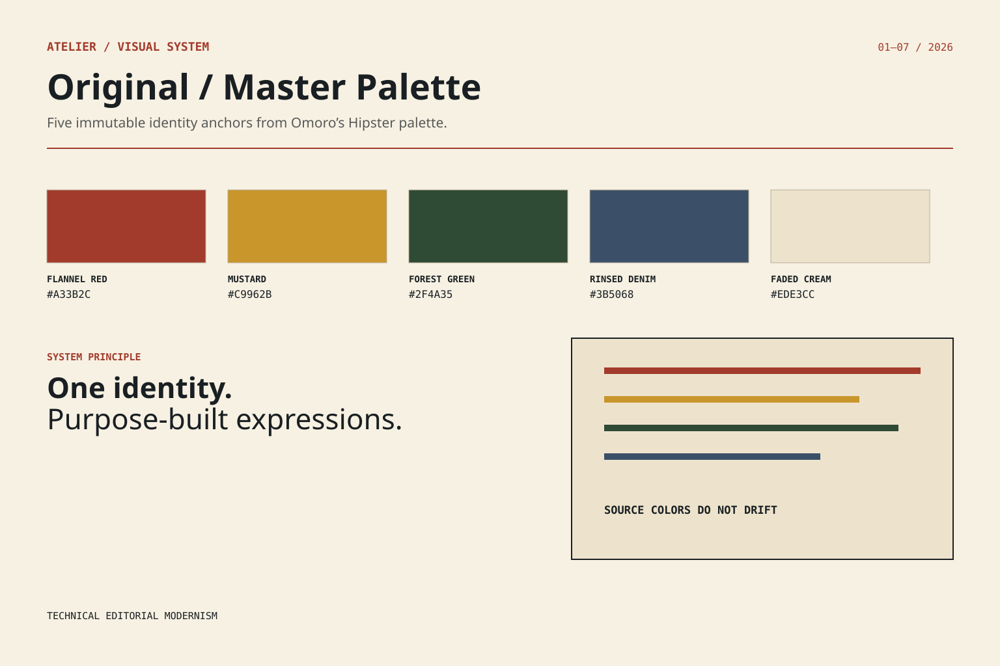
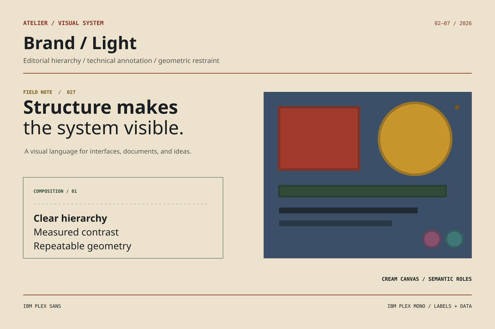
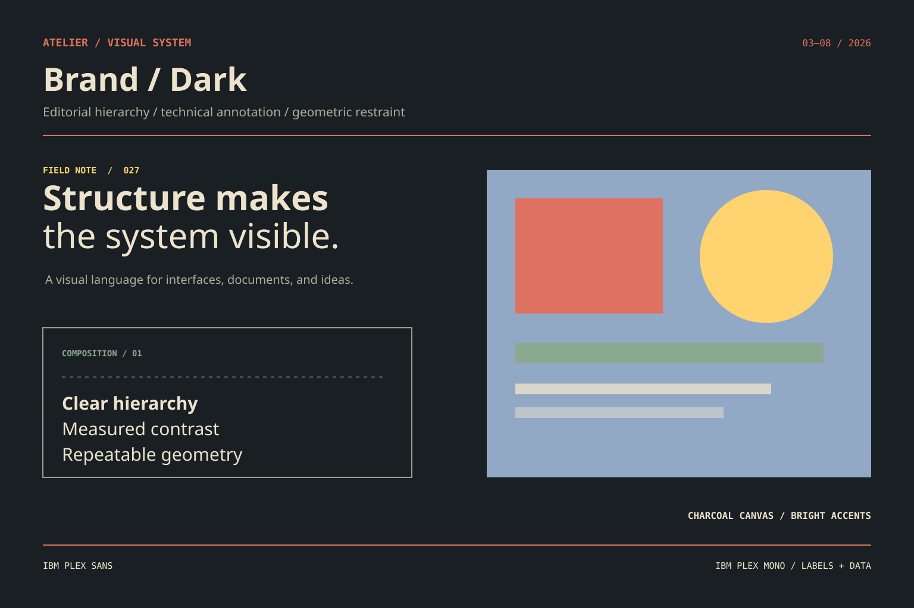
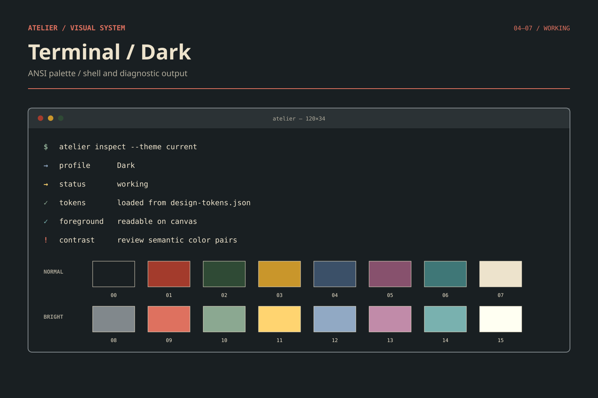
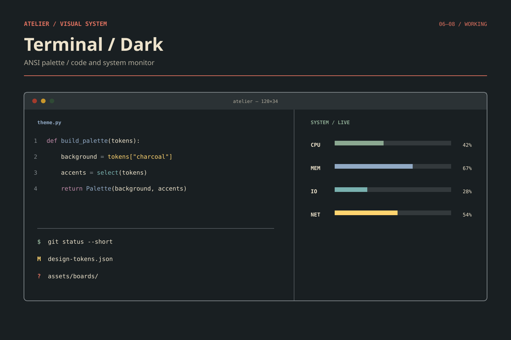
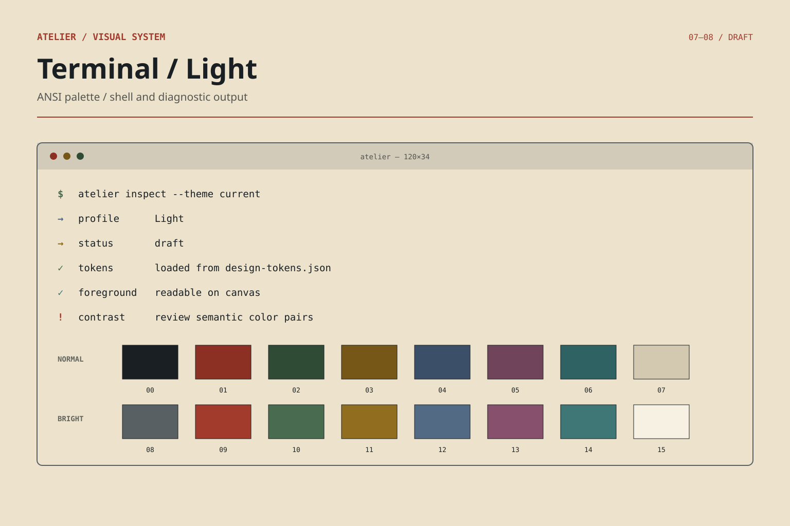
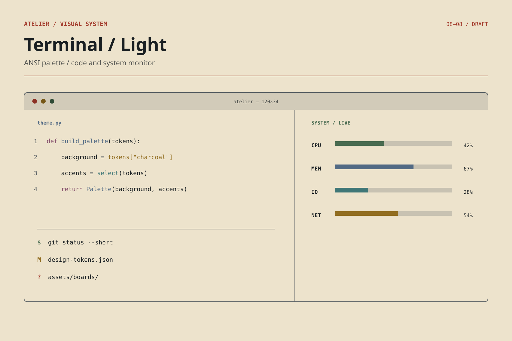

# Atelier

Atelier is the theme and visual identity system for `placerte`. It combines editorial typography, technical diagrams and annotations, and restrained geometric forms under a direction called **Technical Editorial Modernism**.

The system is designed to remain recognizable across websites, presentations, documents, terminals, and code-oriented interfaces without forcing every medium to use colors in the same way.



## Design language

- **Editorial:** strong hierarchy, asymmetric composition, and deliberate whitespace
- **Technical:** grids, schematics, labels, annotations, and data-focused layouts
- **Geometric:** balanced shapes used as structure and emphasis rather than decoration
- **Typography:** IBM Plex Sans for headings and body text; IBM Plex Mono for code and technical details

## Master palette

The five identity anchors come from Omoro's [Hipster palette](https://www.omoro.io/palettes/hipster) and remain unchanged in Atelier.

| Color | HEX | Role |
|---|---|---|
| Flannel Red | `#A33B2C` | Rust/red accent |
| Mustard | `#C9962B` | Warm yellow accent |
| Forest Green | `#2F4A35` | Earthy green accent |
| Rinsed Denim | `#3B5068` | Muted blue accent |
| Faded Cream | `#EDE3CC` | Light neutral and canvas |

Atelier also uses derived Charcoal (`#191F22`) as its primary dark background. It is a supporting neutral, not part of the original five-color palette.

## Theme families

Atelier separates brand presentation from terminal behavior:

| Theme | Purpose |
|---|---|
| **Original** | Immutable master/reference palette |
| **Brand Light** | Cream canvas with original colors as accents |
| **Brand Dark** | Charcoal canvas with role-based original and derived accents |
| **Terminal Dark** | ANSI-aware dark terminal palette |
| **Terminal Light** | ANSI-aware light terminal palette; still in development |

This distinction is intentional: brand palettes prioritize identity and composition, while terminal palettes must also provide readable ANSI colors and predictable software behavior.

Brand Dark does not choose between muted and bright colors globally. It assigns them by function:

| Semantic role | Color source | Typical use |
|---|---|---|
| `surface` | Original master colors | Large shapes, panels, and chart areas |
| `detail` | Brighter derivatives | Labels, icons, fine lines, and small indicators |
| `subtle` | Muted derivatives | Borders, grids, and secondary structure |

The size, adjacency, and importance of an element still matter. Semantic roles are defaults, not permission to skip contrast checks.

## Reference boards

These boards are deterministic SVGs generated from [`design-tokens.json`](design-tokens.json). Unlike generative moodboards, their fills use the declared HEX values exactly.

| Brand Light | Brand Dark |
|---|---|
|  |  |


### Terminal Dark

| Shell and ANSI palette | Code and system monitor |
|---|---|
|  |  |

### Terminal Light — draft

The light-terminal mapping is a concrete candidate for evaluation, not a finalized palette.

| Shell and ANSI palette | Code and system monitor |
|---|---|
|  |  |

Regenerate every board after changing tokens:

```bash
python tools/generate_boards.py
```

The earlier GPT-generated moodboards are retained in `references/concepts/` as directional history, not color-authoritative references.
The retired Brand Darker board is retained in `references/history/` to preserve the design decision trail.

## Project status

Atelier is currently a working design specification. The master palette and overall direction are established, while several implementation details still need validation:

- verify the saved Terminal Dark values against their source theme;
- finalize and contrast-test the Terminal Light ANSI palette;
- test colored text and interactive states across brand variants; and
- turn the conceptual tokens into platform-specific themes and templates.

See [atelier-theme-system.md](atelier-theme-system.md) for the complete specification, current token model, accessibility cautions, and open decisions.

## Repository contents

```text
.
├── assets/boards/                 # Generated, exact-color SVG references
├── references/concepts/           # Earlier generative concept boards
├── references/history/            # Retired deterministic references
├── tools/generate_boards.py       # Deterministic SVG generator
├── design-tokens.json             # Shared machine-readable colors
├── atelier-theme-system.md
└── AGENTS.md
```

## Guiding rule

One visual identity, multiple purpose-built expressions. Do not conflate original, bright, and dimmed colors—or treat a dark brand layout as though it were an ANSI terminal palette.

## License

Released under the [MIT License](LICENSE).
